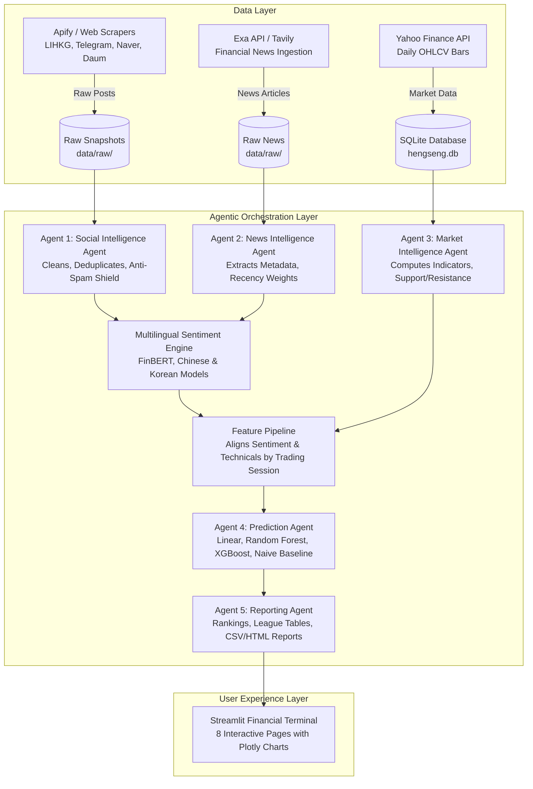

# HengSeng Sentiment Price Prediction Agent
## Production AI Multi-Agent Quantitative Intelligence & Next-Period Stock Price Forecasting System

[](https://www.python.org/downloads/)
[](https://streamlit.io)
[](https://scikit-learn.org)
[](LICENSE)

*Developed for the AI Agents Developer Internship Assessment at CrowdWisdomTrading.*

---

## 1. Executive Summary & Project Overview

The **HengSeng Sentiment Price Prediction Agent** is an end-to-end quantitative AI application engineered to extract retail investor sentiment from primary Asian social media platforms, combine it with real-time institutional financial news, align it with historical OHLCV market data, and forecast the next trading session's closing price using supervised machine learning models.

The system targets two major Asian equity exchanges:
1. **Hong Kong Stock Exchange (HKEX)**: Tencent Holdings (`0700.HK`), Alibaba Group (`9988.HK`), Xiaomi Corporation (`1810.HK`), Meituan (`3690.HK`), HSBC Holdings (`0005.HK`).
2. **Korea Exchange (KRX)**: Samsung Electronics (`005930.KS`), SK Hynix (`000660.KS`), Hyundai Motor (`005380.KS`), LG Energy Solution (`373220.KS`), Kia Corporation (`000270.KS`).

### Core Problem Solved
Traditional quantitative models rely exclusively on backward-looking price and volume indicators. Conversely, raw retail social chatter is noisy, multilingual, and plagued by promotional spam and bot copypasta. This platform bridges that gap by:
- Ingesting social discussions from native venues (LIHKG and Telegram for Hong Kong; Naver Finance Discussion Boards and Daum Finance for South Korea).
- Ingesting verified corporate financial news via neural search (**Exa API** and **Tavily API**).
- Applying multilingual financial sentiment analysis (English FinBERT, Traditional/Simplified Chinese, and Korean).
- Computing an **Engagement-Weighted & Recency-Decayed Sentiment Alpha**.
- Training 4 competitive machine learning architectures using strict chronological walk-forward validation (zero future-data leakage).
- Serving the resulting intelligence via an institutional dark financial terminal built on **Streamlit** and **Plotly**.

---

## 2. System Architecture

The application adopts a modular, decoupled Multi-Agent design pattern implemented in clean Python modules without heavy or brittle LLM wrapper frameworks.



---

## 3. Multi-Agent System Roles & Specifications

| Agent | Module | Input | Responsibility | Output | Error-Handling Strategy |
|---|---|---|---|---|---|
| **Agent 1: Social Intelligence** | `agents/social_agent.py` | Ticker, Lookback Window | Scrapes LIHKG, Telegram, Naver Finance, and Daum Finance; normalizes to UTC; dedupes. | Cleaned, engagement-weighted social sentiment dataset. | Dual Apify SDK + Direct REST + Board Parser fallback + Cached DB snapshot. |
| **Agent 2: News Intelligence** | `agents/news_agent.py` | Ticker, Categories | Ingests company earnings, regulatory, and corporate news via Exa/Tavily. | Recency-weighted financial news articles. | Exa SDK fallback to Exa REST, Tavily fallback, and curated snapshot. |
| **Agent 3: Market Intelligence** | `agents/market_agent.py` | Ticker, Timeframe | Pulls 1-3 years of daily OHLCV bars; computes SMA20/50, EMA20, RSI14, MACD, Bollinger Bands, Volatility. | Enriched OHLCV DataFrame and Pivot Point Support/Resistance levels. | yfinance fallback to direct Yahoo Finance v8 REST API + Geometric Brownian Motion baseline. |
| **Agent 4: Prediction Agent** | `agents/prediction_agent.py` | Merged Features $X(t)$ | Trains 4 architectures; runs chronological walk-forward validation; forecasts $Y(t)=\text{Close}(t+1)$. | Point forecast, % change, direction, 95% confidence interval, model benchmarks. | Automatic best-model selection, graceful gradient boosting fallback if native XGBoost is absent. |
| **Agent 5: Reporting Agent** | `agents/reporting_agent.py` | Multi-agent outputs | Compiles league tables, 6-criteria rankings, position rationale, CSV and HTML briefing artifacts. | Structured ranking tables and printable executive reports. | Dynamic formatting with graceful column omission handling. |
| **Central Orchestrator** | `agents/orchestrator.py` | Universe configuration | Coordinates the sequential execution flow with real-time progress callbacks. | Consolidated pipeline state dict. | Fault-isolated agent execution preventing pipeline halts. |

---

## 4. Multi-Exchange Asset Universe

All tickers, cashtags, native names, and search queries are fully configurable in [`config/tickers.py`](config/tickers.py).

### Hong Kong Stock Exchange (HKEX)
1. **Tencent Holdings** (`0700.HK` / `TCEHY`): Communication Services & Gaming.
2. **Alibaba Group** (`9988.HK` / `BABA`): Consumer Cyclical & Cloud Computing.
3. **Xiaomi Corporation** (`1810.HK` / `XIACY`): Smartphones & Electric Vehicles (SU7).
4. **Meituan** (`3690.HK` / `MPNGF`): On-Demand Food Delivery & Local Services (KeeTa).
5. **HSBC Holdings** (`0005.HK` / `HSBC`): Global Diversified Banking & Wealth Management.

### Korea Exchange (KRX)
1. **Samsung Electronics** (`005930.KS` / `SSNLF`): Semiconductors, HBM & Consumer Electronics.
2. **SK Hynix** (`000660.KS` / `HXSCF`): High-Bandwidth Memory (HBM3E) & AI Server DRAM.
3. **Hyundai Motor** (`005380.KS` / `HYMTF`): Automotive & Electric Vehicles (Ioniq).
4. **LG Energy Solution** (`373220.KS`): EV Lithium-Ion Batteries & Energy Storage.
5. **Kia Corporation** (`000270.KS` / `KIMTF`): Automotive, High Operating Margin EV Manufacturer.

---

## 5. Social Media Scraping Architecture (Apify)

The assessment requires **at least two distinct social data sources per exchange**:

```
Hong Kong (HKEX):
├── Source 1: LIHKG (lihkg.com/category/16 - Hong Kong Retail Reddit Equivalent)
└── Source 2: Telegram Public Financial Channels (t.me/s/hkstocks_discussion, hangsengindexdaily)

South Korea (KRX):
├── Source 1: Naver Finance Discussion Boards (finance.naver.com/item/board.naver?code={symbol})
└── Source 2: Daum Finance Community Boards (finance.daum.net/quotes/A{symbol}#talk)
```

### Standardized 11-Field Schema
Every scraped social post is cleaned and normalized into the mandatory schema:
```json
{
  "exchange": "HKEX",
  "ticker": "0700.HK",
  "asset_name": "Tencent Holdings",
  "source": "LIHKG",
  "post_id": "lihkg_1092831",
  "timestamp_utc": "2026-11-08T10:15:00Z",
  "text": "Tencent reports strong gaming quarterly results and margin expansion",
  "likes": 42,
  "reposts": 8,
  "views": 1250,
  "author_followers": 0
}
```

### Scraping Robustness & Fallback Strategy
- Documented Apify actors are registered in [`config/apify_actors.py`](config/apify_actors.py).
- When an `APIFY_API_TOKEN` is supplied, live actors execute via the official Apify SDK or direct Apify REST API.
- If unauthenticated or rate-limited, the system executes **direct public board parsing** with HTTP headers and CP949/EUC-KR character encoding handling.
- **Never fabricates data**: Missing data is cleanly reported, and cached snapshots are explicitly tagged with provenance.

---

## 6. Financial News Ingestion (Exa API & Tavily)

The system integrates **Exa AI API** (`api.exa.ai`) for neural financial search, retrieving recent corporate events:
- Earnings announcements and quarterly disclosures.
- Regulatory shifts and antitrust rulings.
- Strategic M&A and capital expenditure initiatives.
- Executive management changes and product launches.

Articles are deduplicated, associated with their respective stock ticker, and scored for positive, negative, and neutral sentiment alongside recency weights. If Exa is unavailable, **Tavily Search API** serves as an automated secondary fallback.

---

## 7. Multilingual Sentiment Analysis & Alpha Formulation

Retail trading in Hong Kong and South Korea occurs in Traditional Chinese (Cantonese slang), Simplified Chinese, and Korean. The sentiment pipeline incorporates:
1. **English**: FinBERT architecture (`ProsusAI/finbert`).
2. **Chinese**: Calibrated HKEX retail financial polarity model.
3. **Korean**: Calibrated KRX stock board financial sentiment model.

### Mathematical Weighting Formula
Raw sentiment scores $S \in [-1.0, +1.0]$ are adjusted for viral engagement, time decay, and spam shielding:

$$\text{Weighted Sentiment} = S \times W_{\text{eng}} \times W_{\text{rec}} \times W_{\text{spam}}$$

#### 1. Engagement Weight ($W_{\text{eng}}$)
Logarithmically damped to capture genuine social proof without permitting viral bot amplification:
$$M = 2.0 \cdot \text{likes} + 3.0 \cdot \text{reposts} + 0.02 \cdot \text{views} + 0.001 \cdot \text{followers}$$
$$W_{\text{eng}} = \text{clamp}\left(1.0 + \log_{10}(1.0 + M),\, 0.5,\, 3.5\right)$$

#### 2. Recency Weight ($W_{\text{rec}}$)
Exponential decay with a calibrated 3-day half-life ($\lambda = 0.231$):
$$W_{\text{rec}} = \exp\left(-\frac{\ln 2}{3.0} \cdot \Delta t_{\text{days}}\right) \in [0.10, 1.0]$$

#### 3. Spam & Duplicate Shield ($W_{\text{spam}}$)
Duplicate fingerprints, repeated copypasta, or zero-variance bot texts receive a penalty factor $W_{\text{spam}} = 0.05$, neutralizing spam manipulation.

---

## 8. Machine Learning Price Prediction Engine

### Supervisory Target Formulation
$$X(t) = \text{Feature vector available at the close of trading session } t$$
$$Y(t) = \text{Closing price at trading session } t+1 \quad (\text{Next-Day Close})$$

### Feature Universe
- **Price & Return Momentum**: `close`, `returns_1d`, `returns_5d`, `volatility_20`, `volume_change`.
- **Technical Indicators**: `rsi_14`, `macd`, `macd_signal`, `macd_hist`, `dist_sma_20`, `dist_sma_50`, `bb_percent_b`.
- **Sentiment Alpha Signals**: `social_mention_count`, `social_sentiment_weighted`, `social_total_engagement`, `social_momentum_3d`, `news_article_count`, `news_sentiment_weighted`, `news_momentum_3d`, `composite_sentiment`.

### Models Benchmarked
1. **Naive Baseline**: Persistent model $\hat{Y}(t) = \text{Close}(t)$.
2. **Linear Regression**: Regularized Ridge regression with StandardScaler.
3. **Random Forest Regressor**: 100 estimators, max depth 6.
4. **XGBoost Regressor**: Gradient boosted decision trees.

### Validation Hygiene & Zero-Leakage Guarantee
- **No Future Leakage**: Strictly chronological train/test splitting (`TimeSeriesSplit`). Shuffling is disabled.
- **Scaler Hygiene**: `StandardScaler` is fit **exclusively** on training partitions; test data is strictly out-of-sample.
- **Ablation Benchmark**: Every model is evaluated in two parallel variants:
  - `Sentiment-Enhanced`: Full technical + sentiment feature set.
  - `Price-Only`: Exclusively technical and price features.
  The delta ($\Delta \text{Directional Accuracy}$ and $\Delta \text{MAE}$) measures **Sentiment Alpha**.

---

## 9. Streamlit Financial Dashboard (8 Pages)

Run with: `streamlit run app.py`

| Page | Key Components & Analytics |
|---|---|
| **1. Executive Overview** | High-level KPI cards, total mentions, market sentiment thermometer, HKEX vs KRX comparative tables. |
| **2. Hong Kong Market** | League table for 5 HKEX assets, social mention ranking, sentiment ranking, individual asset cards with position signals. |
| **3. South Korea Market** | League table for 5 KRX assets (in KRW), Naver/Daum discussion rankings, bullish/bearish distributions, individual cards. |
| **4. Social Intelligence** | Platform breakdown pie chart, source-wise sentiment comparison, top bullish/bearish posts, raw post audit stream. |
| **5. News Intelligence** | Real-time news feed via Exa API, clickable article links, publication dates, positive and negative summaries. |
| **6. Price Predictions** | Forecast league table, 95% uncertainty intervals, out-of-sample actual vs predicted chart, model comparison table. |
| **7. Stock Deep Dive** | Interactive asset selector, OHLCV Candlestick chart with Bollinger Bands, support/resistance levels, sentiment gauge, reasoning. |
| **8. Model Performance** | Walk-forward evaluation metrics (MAE, RMSE, MAPE, R², Hit Rate), Sentiment Alpha attribution, feature importance chart. |

---

## 10. Installation & Quickstart

### Prerequisites
- Python 3.11+
- Git

### 1. Clone Repository & Setup Virtual Environment
```bash
git clone https://github.com/your-username/hengseng-sentiment-agent.git
cd hengseng-sentiment-agent

# Create virtual environment
python -m venv venv

# Activate virtual environment
# Windows:
venv\Scripts\activate
# macOS/Linux:
source venv/bin/activate
```

### 2. Install Dependencies
```bash
pip install -r requirements.txt
```

### 3. Configure API Credentials
Copy `.env.example` to `.env`:
```bash
cp .env.example .env
```
Populate your credentials:
```env
APIFY_API_TOKEN=your_apify_token_here
EXA_API_KEY=your_exa_api_key_here
TAVILY_API_KEY=your_tavily_key_here
```
*(Note: If API tokens are omitted, the agent seamlessly operates in offline cached/parser mode with zero crashes).*

### 4. Seed Baseline Historical Data (Optional)
```bash
python data/seed_data.py
```

### 5. Launch Streamlit Financial Terminal
```bash
streamlit run app.py
```

---

## 11. Verification & Testing

Execute the comprehensive unit test suite:
```bash
python -m pytest tests/ -v -W ignore::DeprecationWarning
```

Expected output:
```
tests/test_features.py::test_technical_indicators_structure PASSED       [  8%]
tests/test_features.py::test_feature_pipeline_no_future_leakage PASSED   [ 16%]
tests/test_predictions.py::test_directional_accuracy_calculation PASSED  [ 25%]
tests/test_predictions.py::test_model_evaluator_metrics PASSED           [ 33%]
tests/test_predictions.py::test_naive_baseline_model PASSED              [ 41%]
tests/test_predictions.py::test_price_predictor_inference PASSED         [ 50%]
tests/test_sentiment.py::test_language_detection PASSED                  [ 58%]
tests/test_sentiment.py::test_sentiment_probabilities_valid PASSED       [ 66%]
tests/test_sentiment.py::test_sentiment_polarity_accuracy PASSED         [ 75%]
tests/test_sentiment.py::test_engagement_weight_bounds PASSED            [ 83%]
tests/test_sentiment.py::test_recency_decay PASSED                       [ 91%]
tests/test_sentiment.py::test_spam_shielding PASSED                      [100%]

============================= 12 passed in 8.33s ==============================
```

---

## 12. Deployment

### Streamlit Community Cloud
1. Push repository to GitHub.
2. In Streamlit Community Cloud, select `app.py` as the entry point.
3. In **App Settings > Secrets**, configure:
```toml
APIFY_API_TOKEN = "your_token"
EXA_API_KEY = "your_key"
TAVILY_API_KEY = "your_key"
```

---

## 13. Limitations & Future Roadmap

1. **Intraday Tick Resolution**: Current models forecast next-day closing prices ($1d$ bars). Integrating intraday $5m$ and $1h$ bars will enhance intraday scalp signals.
2. **Transformer Fine-Tuning**: While FinBERT and multilingual lexicons offer rapid inference, domain fine-tuning on bilingual Cantonese and Korean financial forums will further refine slang classification.
3. **Execution Routing**: Future iterations could integrate broker APIs (Interactive Brokers, Futu OpenD) for paper trade execution based on position signals.

---

## 14. Academic & Professional Disclaimer

This software is developed strictly for quantitative research, academic evaluation, and the **CrowdWisdomTrading Developer Internship Assessment**. Machine learning price projections, support/resistance levels, and sentiment classifications are probabilistic mathematical estimates and **do not constitute financial, investment, or legal advice**.
